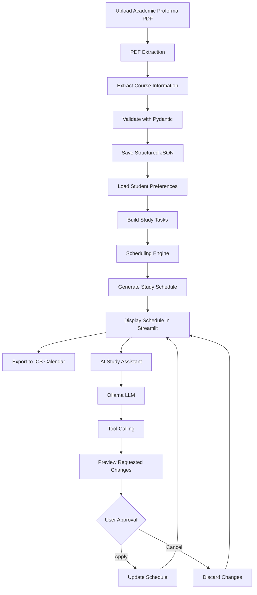

<div align="center">

# Study Agent

### AI-Powered Personalized Study Scheduler

An intelligent study scheduling system that converts academic proforma documents into personalized study plans, manages assessment preparation, and provides an AI assistant for schedule management.

<br>


<br>

**Turn your academic workload into a structured and manageable study schedule.**

</div>

---

## Overview

Study Agent is an AI-powered academic scheduling application designed to help university students organize their study activities based on their academic requirements and personal availability.

The application extracts academic information from university proforma PDFs, including weekly topics, credit hours, Student Learning Time (SLT), and assessment details.

Using this information, its scheduling engine generates study sessions while considering class schedules, meal times, personal commitments, study preferences, and assessment deadlines.

Study Agent also integrates a locally hosted Large Language Model (LLM) through Ollama. Users can interact with the AI assistant to retrieve, modify, and manage their study schedules using natural language.

## Features

### 1. Academic Proforma Extraction

Upload academic proforma PDFs to automatically extract:

- Course code and course name.
- Credit hours.
- Weekly topics and learning activities.
- Student Learning Time (SLT).
- Assessment names and weightage.

Extracted information is validated using Pydantic models and stored as structured JSON files.

### 2. Personalized Study Scheduling

Generate study schedules based on:

- Weekly SLT requirements.
- Assessment preparation hours.
- Assessment deadlines.
- University class timetables.
- Meal times and personal commitments.
- Maximum daily study hours.
- Preferred study hours.
- Free evenings and lighter study days.

The scheduling engine distributes study sessions across available time slots while prioritizing upcoming deadlines.

### 3. Assessment Management

Manage assessment preparation requirements through the application.

- Set assessment due dates.
- Configure preparation hours.
- Define default preparation weeks.
- Organize preparation sessions before assessment deadlines.
- View assessment weightage extracted from proforma documents.

### 4. AI Study Assistant

Interact with a local AI assistant powered by Qwen 2.5 7B through Ollama.

The assistant supports natural-language schedule management through tool calling.

Available operations include:

| Operation | Description |
|---|---|
| View Schedule | Retrieve study sessions by date, week, or subject |
| Move Study Block | Reschedule an existing study session |
| Add Personal Event | Add meetings, trips, or other commitments |
| Delete Personal Event | Remove a previously added personal event |
| Pin Study Block | Keep a study session at a fixed time |
| Unpin Study Block | Allow a previously fixed session to be rescheduled |
| Clear Pins | Remove schedule pins |
| Block Day | Prevent study sessions from being scheduled on a date |
| Unblock Day | Make a previously blocked date available |
| Replan Schedule | Generate a new schedule while preserving constraints |
| Undo Changes | Restore a previous schedule state |

The assistant requests user approval before applying schedule modifications.

### 5. Schedule Management

- View generated study sessions.
- Filter schedules by semester week.
- Move study sessions.
- Add personal events.
- Pin important study sessions.
- Block unavailable days.
- Replan without losing pinned sessions.
- Undo previous schedule modifications.

### 6. Calendar Export

Export generated study schedules as `.ics` calendar files.

- Compatible with Google Calendar and other calendar applications supporting iCalendar.
- Uses the `Asia/Kuala_Lumpur` timezone by default.
- Includes a 10-minute event reminder.
- Supports calendar event summaries containing subject and study activity information.

---

## Application Workflow



---

## Scheduling Algorithm

Study Agent uses a custom greedy scheduling algorithm to distribute study tasks across available time slots.

### Task Generation

The system generates two main types of study tasks:

**Weekly Study Tasks**

Weekly topics are converted into study blocks using their SLT requirements.

The number of blocks is calculated using:

\[
\text{Blocks} =
\left\lceil
\frac{\text{SLT Hours} \times 60}{\text{Block Duration}}
\right\rceil
\]

For example, with a 50-minute study block and 3 hours of SLT:

\[
\left\lceil \frac{180}{50} \right\rceil = 4
\]

The task requires four study blocks.

**Assessment Preparation Tasks**

Assessment preparation tasks are generated using configurable preparation hours.

- When a due date is available, preparation is scheduled within the 13 days before the assessment.
- When the due date is unknown, the configured default preparation weeks are used.

### Scheduling Strategy

The scheduler considers:

1. Available study time for each day.
2. Class and meal commitments.
3. Maximum daily study hours.
4. Block duration and break duration.
5. Assessment and weekly task deadlines.
6. Pinned study sessions.
7. Blocked days.
8. Free evenings and lighter study days.

Tasks are prioritized using their remaining workload, available days, and deadlines.

The scheduler reports tasks that could not fit into the available schedule.

---

## Technology Stack

| Technology | Purpose |
|---|---|
| Python 3.12+ | Main programming language |
| Streamlit | Interactive web application |
| Ollama | Local LLM runtime |
| Qwen 2.5 7B | AI study assistant |
| pdfplumber | PDF table and text extraction |
| Pydantic | Structured data validation |
| OR-Tools | Declared scheduling dependency |
| JSON | Configuration and local data storage |
| iCalendar | Calendar export |
| uv | Python dependency and environment management |

**Note:** The current scheduling implementation uses a custom greedy algorithm. OR-Tools is listed as a dependency but is not used by the scheduler.

---

## System Architecture

The project is organized into separate modules responsible for academic data extraction, schedule generation, schedule management, calendar export, and AI interaction.

| Module | Responsibility |
|---|---|
| `extract.py` | Extract academic information from proforma PDFs |
| `scheduler.py` | Generate study tasks and schedule available time slots |
| `store.py` | Manage schedule data, events, pins, blocked days, and undo history |
| `export_ics.py` | Convert study schedules into iCalendar files |
| `agent.py` | Handle AI conversations and tool calling |
| `app.py` | Provide the Streamlit user interface |

### AI Assistant Architecture

The AI assistant uses a tool-based architecture.

The LLM interprets user requests and selects the appropriate operation. Actual schedule modifications are handled by functions in `store.py`.

This separates language understanding from schedule validation and data modification.

The application also uses an approval flow for changes, allowing users to review proposed modifications before applying them.

---

## Project Structure

```text
study-agent/
│
├── data/
│   ├── DES3083.json
│   └── DES3103.json
│
├── output/
│   ├── schedule.json
│   ├── study_schedule.ics
│   └── undo.json
│
├── proforma/
│   ├── Proforma_SE_Process.pdf
│   └── Proforma_V_V.pdf
│
├── src/
│   ├── study_agent/
│   │   └── __init__.py
│   │
│   ├── app.py
│   ├── agent.py
│   ├── extract.py
│   ├── scheduler.py
│   ├── store.py
│   └── export_ics.py
│
├── config.json
├── pins.json
├── pyproject.toml
├── uv.lock
├── .python-version
└── README.md
```

### Important Files

| File | Description |
|---|---|
| `config.json` | Semester dates, timetable, preferences, and assessment configuration |
| `pins.json` | Pinned schedule blocks and blocked days |
| `data/*.json` | Extracted academic proforma information |
| `output/schedule.json` | Generated study schedule |
| `output/undo.json` | Previous schedule states |
| `output/study_schedule.ics` | Exported calendar events |

---

## Installation

### Prerequisites

Make sure you have the following installed:

| Requirement | Version |
|---|---|
| Python | 3.12 or newer |
| uv | Latest stable |
| Ollama | Latest stable |

### 1. Clone the Repository

```bash
git clone https://github.com/Jacqueson1/study-agent.git

cd study-agent
```

### 2. Install Dependencies

The project uses `uv` for dependency management.

```bash
uv sync
```

### 3. Install and Configure Ollama

Download Ollama:

https://ollama.com/

Pull the Qwen 2.5 7B model:

```bash
ollama pull qwen2.5:7b
```

Start the Ollama service if it is not already running:

```bash
ollama serve
```

The application uses the following default model:

```text
qwen2.5:7b
```

### 4. Configure Your Academic Information

Open `config.json` and update the following sections:

- Semester start date and duration.
- Weekly class timetable.
- Meal times and personal commitments.
- Preferred study hours.
- Maximum daily study hours.
- Study block and break duration.
- Free evening and lighter study day.
- Assessment preparation preferences.

The repository includes example academic data and configuration. Replace these with your own information before generating a personal schedule.

### 5. Run the Application

From the project root:

```bash
uv run streamlit run src/app.py
```

Open the application:

```text
http://localhost:8501
```

---

## Usage Guide

### Step 1: Upload Proforma Documents

Open the **Proformas** tab.

Upload your university proforma PDFs and select the extraction option.

The system extracts the course information and saves the results inside the `data/` directory.

### Step 2: Configure Assessments

Open the **Assessments** tab.

Review the extracted assessment information and configure:

- Assessment due dates.
- Preparation hours.
- Preparation week ranges.

Save your assessment configuration.

### Step 3: Generate Your Study Schedule

Open the **Schedule** tab.

Select the date from which the schedule should begin and generate your study plan.

The application displays:

- Total study blocks.
- Number of study days.
- Tasks that could not be scheduled.
- Study dates and time slots.
- Subject and study activity.
- Pinned study sessions.

### Step 4: Manage Your Schedule with AI

Open the **Chat** tab.

You can request schedule changes using natural language.

Example prompts:

```text
Show my DES3103 schedule for week 6.
```

```text
Move my first DES3103 study block in week 6 to Saturday at 2 PM.
```

```text
Block Friday because I have an event.
```

```text
Replan my schedule while keeping all pinned sessions.
```

Review the proposed changes and select **Apply** or **Cancel**.

### Step 5: Export Your Calendar

Download the `.ics` file from the Schedule tab.

Import it into Google Calendar or another compatible calendar application.

---

## Data Storage

Study Agent uses local JSON files instead of a database server.

| Data | Storage |
|---|---|
| Academic proforma information | `data/` |
| Semester and timetable configuration | `config.json` |
| Pinned blocks and blocked days | `pins.json` |
| Current study schedule | `output/schedule.json` |
| Undo history | `output/undo.json` |
| Calendar export | `output/study_schedule.ics` |

Schedule modifications are validated before being saved.

The application maintains up to 20 previous schedule states for undo operations.

---

## Current Implementation Notes

- The application runs as a local Streamlit web application.
- AI inference uses a locally hosted Ollama model.
- Academic information is extracted from PDF proforma documents.
- Scheduling is performed using a custom greedy algorithm.
- Schedule data is stored in local JSON files.
- AI-proposed schedule changes require user approval.
- Calendar export uses the iCalendar format.
- The application is configured for a single local user and does not implement multi-user accounts or cloud synchronization.

---

## Project Status

<div align="center">


</div>

Study Agent was developed to explore the integration of academic document processing, automated scheduling algorithms, local Large Language Models, and natural-language schedule management.

The project demonstrates how structured academic information can be transformed into a personalized study plan and managed through an AI-powered assistant.

---

## License

No explicit license file is currently included in this repository.

Refer to the repository owner before redistributing or reusing the project.

---

<div align="center">

**Study Agent**

*Plan your studies. Manage your time. Stay organized.*

</div>
